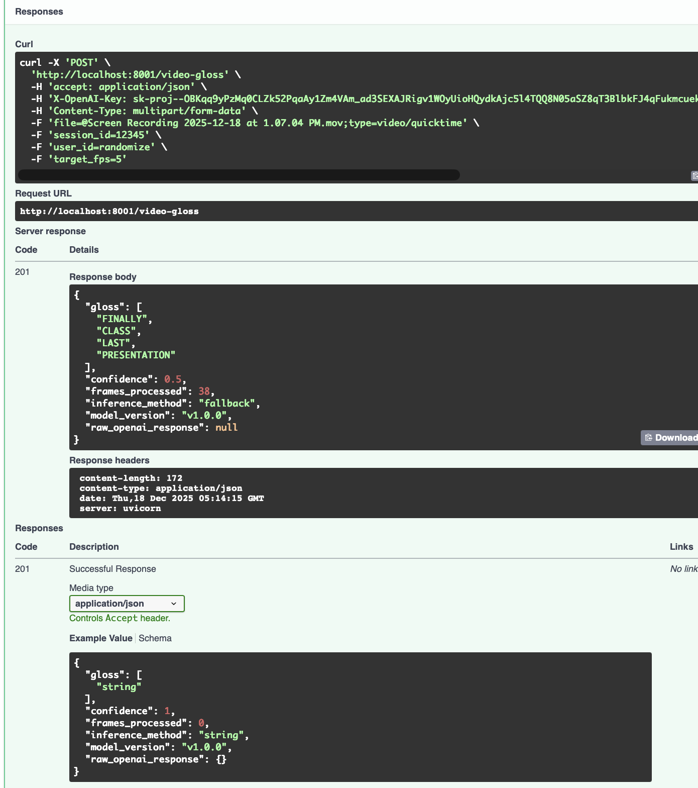

# ASL Model Serving Microservice

## Overview
FastAPI service for ASL landmark extraction and gloss prediction. It extracts 21 hand landmarks from images or videos (MediaPipe when available, stub fallback), predicts gloss tokens via OpenAI GPT-4o (deterministic fallback if unavailable), aggregates recorded videos into a single gloss, and best-effort persists to MySQL in `landmarks` and `video_gloss_requests`.

Quick start:
1) Install deps: `pip install -r requirements.txt`
2) Export DB/OpenAI env vars (see below)
3) Run: `uvicorn main:app --host 0.0.0.0 --port 8000 --reload`
4) Open docs: http://localhost:8000/docs

Key config (env or headers):
- `OPENAI_API_KEY` or `X-OpenAI-Key` header for OpenAI calls; fallback gloss `["FINALLY","CLASS","LAST","PRESENTATION"]` otherwise.
- Optional `mediapipe` dependency for real landmarks; stub used if missing.
- MySQL/Cloud SQL: `DB_HOST`/`DB_PORT` (or `DB_SOCKET`), `DB_NAME`, `DB_USER`, `DB_PASSWORD` for persistence to `landmarks` and `video_gloss_requests`; API still responds if writes fail.

## Models
**LandmarkInput (request)** — from `models/landmark.py`
```json
{
  "session_id": "session-123",
  "user_id": "user-abc",
  "image_url": "https://example.com/frame.jpg",
  "frame_base64": "data:image/jpeg;base64,...",
  "metadata": {"device": "iphone"}
}
```

**LandmarkResult (response)** — from `models/landmark.py`
```json
{
  "id": "550e8400-e29b-41d4-a716-446655440100",
  "session_id": "session-123",
  "user_id": "user-abc",
  "landmarks": [[0.5, 0.6], [0.52, 0.58], "..."],
  "method": "mediapipe",
  "extracted_at": "2025-01-16T12:34:56Z",
  "metadata": {"device": "iphone"}
}
```

**LandmarkUpdate (request)** — from `models/landmark.py`
```json
{
  "session_id": "session-123",
  "user_id": "user-abc",
  "landmarks": [[0.5, 0.6], [0.52, 0.58], "..."],
  "metadata": {"device": "iphone"}
}
```

**GlossPredictionInput (request)** — from `models/gloss.py`
```json
{
  "session_id": "session-123",
  "user_id": "user-abc",
  "landmark_id": "550e8400-e29b-41d4-a716-446655440100",
  "landmarks": null
}
```

**GlossPredictionResult (response)** — from `models/gloss.py`
```json
{
  "id": "550e8400-e29b-41d4-a716-446655440200",
  "session_id": "session-123",
  "user_id": "user-abc",
  "landmark_id": "550e8400-e29b-41d4-a716-446655440100",
  "gloss": ["HELLO"],
  "confidence": 0.93,
  "inference_method": "openai",
  "model_version": "v1.0.0",
  "raw_openai_response": {"choices": []},
  "created_at": "2025-01-16T12:34:56Z"
}
```

**VideoGlossResponse (response)** — from `main.py`
```json
{
  "gloss": ["HELLO"],
  "confidence": 0.93,
  "frames_processed": 12,
  "inference_method": "openai",
  "model_version": "v1.0.0",
  "raw_openai_response": {"choices": []}
}
```

**video_gloss_requests (DB row)** — persisted when DB available
```json
{
  "id": "uuid",
  "video_uri": "sample.mp4",
  "landmarks": [[[0.5,0.6],"..."]],
  "gloss": ["FINALLY","CLASS","LAST","PRESENTATION"],
  "confidence": 0.5,
  "inference_method": "fallback",
  "raw_openai_response": null,
  "detected": false
}
```

## API Methods
**Landmarks**
- POST /landmarks — Extract 21 hand landmarks from an image/frame (multipart `file`, MediaPipe if installed, else stub).
- GET /landmarks — List in-memory landmark records.
- GET /landmarks/{id} — Retrieve a landmark record.
- PUT /landmarks/{id} — Update a landmark record (landmarks, session/user/metadata) and best-effort persist to MySQL.
- DELETE /landmarks/{id} — Delete a landmark record.

**Gloss Predictions**
- POST /gloss-predictions — Predict gloss tokens from a `landmark_id` or inline `landmarks`; best-effort persist to MySQL.
- GET /gloss-predictions — List gloss predictions in memory.
- GET /gloss-predictions/{id} — Retrieve a gloss prediction.
- PUT /gloss-predictions/{id} — Recompute gloss using new landmarks or a different landmark.
- DELETE /gloss-predictions/{id} — Remove a gloss prediction (and delete DB row if present).

**Video Gloss**
- POST /video-gloss — Upload a recorded video, sample frames, extract landmarks, and return one gloss; best-effort persist to MySQL.

**Service Info**
- GET / — Root service info (links to docs and key endpoints).
- GET /docs — OpenAPI UI.

## Deployment
- Install deps: `pip install -r requirements.txt`
- Run locally: export env and start
  ```bash
  export DB_HOST=136.113.187.126
  export DB_PORT=3306
  export DB_NAME=model_serving_db
  export DB_USER=model_serving_user
  export DB_PASSWORD='H7!qZ9p#L2vBn3'
  uvicorn main:app --host 0.0.0.0 --port 8000 --reload
  ```
- Docker (pass env inline):
  ```bash
  docker build -t model-serving .
  docker run -p 8001:8001 \
    -e DB_HOST=136.113.187.126 \
    -e DB_PORT=3306 \
    -e DB_NAME=model_serving_db \
    -e DB_USER=model_serving_user \
    -e DB_PASSWORD='H7!qZ9p#L2vBn3' \
    model-serving
  ```
  If you previously built before OpenCV libs were added, rebuild with `docker build --no-cache -t model-serving .`.
- Quick deploy helper: `./deploy-to-gcp.sh`
- Docs: http://localhost:8000/docs

**Database schema**
- Apply schema to MySQL/Cloud SQL (creates `landmarks` and `video_gloss_requests`):
  ```bash
  mysql -h $DB_HOST -P $DB_PORT -u $DB_USER -p$DB_PASSWORD $DB_NAME < db/schema.sql
  ```

## Testing
- OpenAPI docs: start the server, open http://localhost:8000/docs
- OpenAPI docs UI:

  
- Curl examples:
  - Landmarks (image):
    ```bash
    curl -X POST http://localhost:8000/landmarks \
      -H "Accept: application/json" \
      -F "file=@frame.jpg"
    ```
  - Gloss from landmarks:
    ```bash
    curl -X POST http://localhost:8000/gloss-predictions \
      -H "Content-Type: application/json" \
      -H "X-OpenAI-Key: sk-..." \
      -d '{"landmarks": [[0.5,0.6],[0.52,0.58],"..."]}'
    ```
  - Video gloss:
    ```bash
    curl -X POST http://localhost:8000/video-gloss \
      -H "Accept: application/json" \
      -H "X-OpenAI-Key: sk-..." \
      -F "file=@sample.mp4" \
      -F "target_fps=5"
    ```
- API test run:

  
